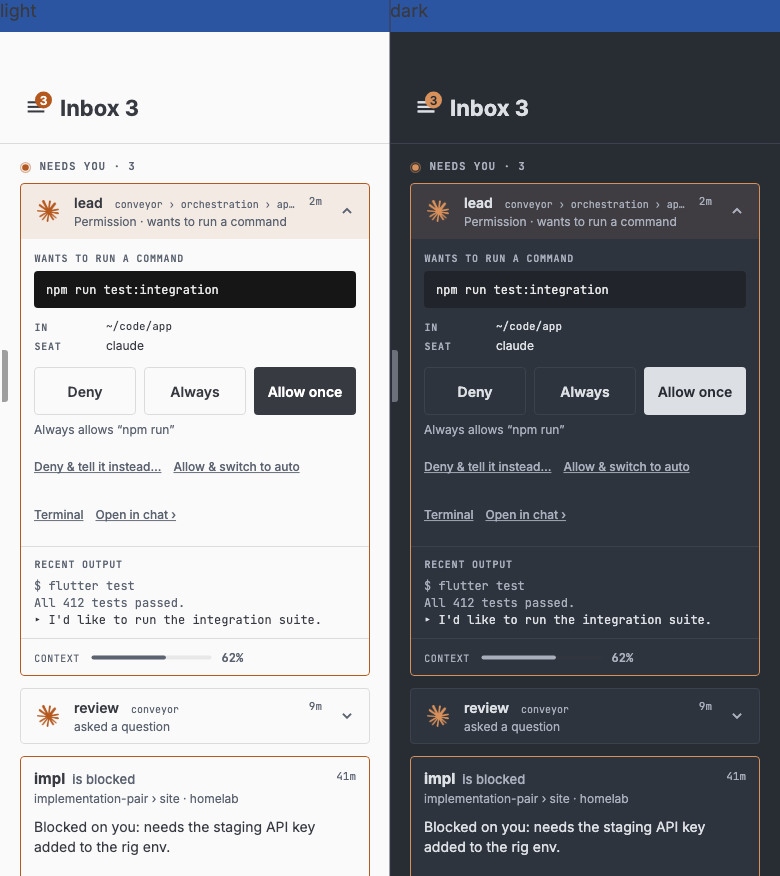
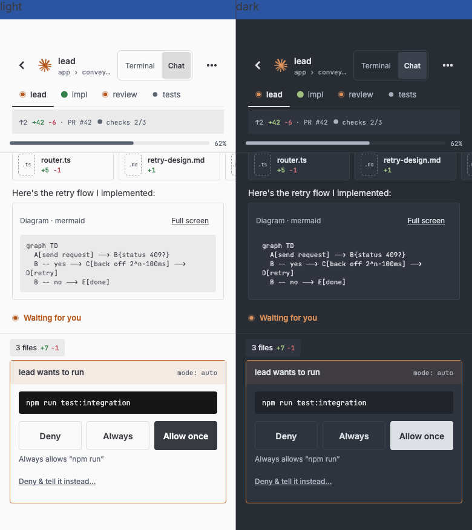
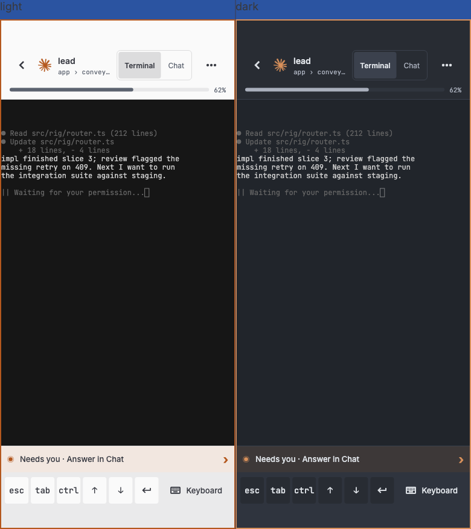
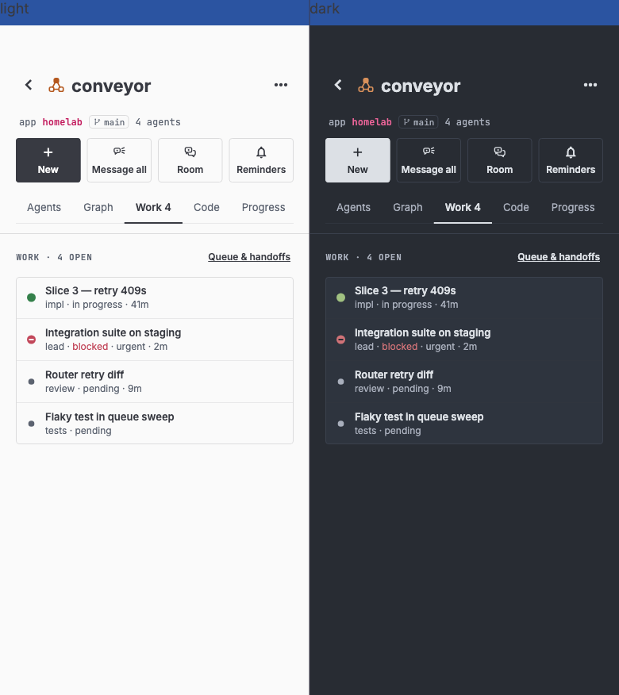
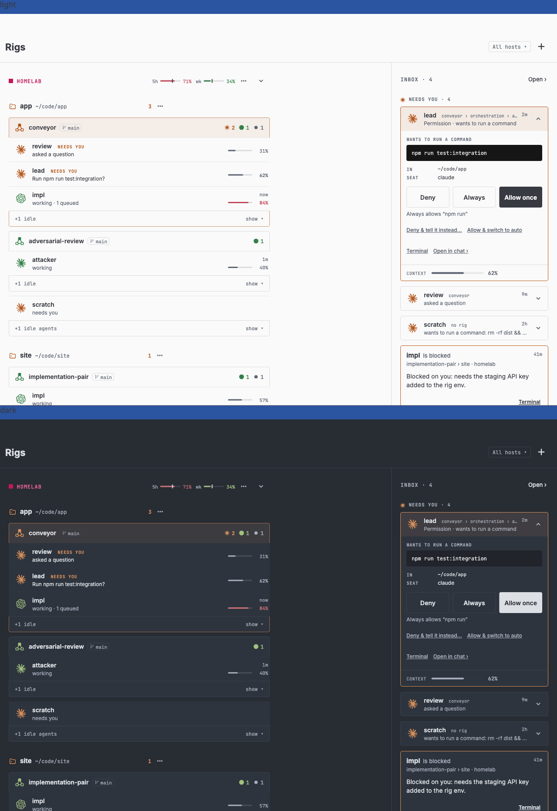

# PocketRig

[](https://github.com/knezzz/PocketRig/actions/workflows/ci.yml)

A small phone app for [OpenRig](https://github.com/mvschwarz/openrig): your rigs grouped by project folder, what's waiting on you, a terminal into any seat, and a one-tap shell in any project folder. It connects over Tailscale, with SSH as the fallback.

## Screenshots

Rendered from the golden tests with fake data (dark on the right of each pair).

| | |
|---|---|
|  |  |
|  |  |



## First run

```sh
cd PocketRig
flutter pub get
flutter test
flutter run
```

The `ios/` and `android/` folders are committed, so no `flutter create` is needed. Built and tested with Flutter 3.47.9 (Dart 3.13).

## Building

The Xcode projects (`ios/`, `macos/`) are signed with the author's team. Set your own `DEVELOPMENT_TEAM` in Xcode (Runner target, Signing & Capabilities), and change the bundle ids if you ship your own build.

**OpenRig version:** the daemon API used here was checked against **OpenRig 0.7.6** (`@openrig/cli`). The API is internal and changes between releases, so if `rig --version` on your host is newer and something breaks, the fix belongs in `lib/api/openrig_client.dart`.

**Plain HTTP to the tailnet** is already allowed in the committed platform folders. The daemon speaks `http://`, and Tailscale encrypts the traffic:

- Android: `INTERNET` permission and `android:usesCleartextTraffic="true"` in `android/app/src/main/AndroidManifest.xml`
- iOS: `NSAppTransportSecurity` → `NSAllowsArbitraryLoads` in `ios/Runner/Info.plist`

## Design

The screens are grey, with only state colored, and dark is the primary theme (Settings → Appearance switches to Light or System).

- **Tabs:** Inbox (home: everything waiting on you, answerable in place) · Projects · Settings.
- **Status shapes** (`lib/ui/status_shape.dart`), the same everywhere:

  | State | Shape | Color |
  |---|---|---|
  | needs you | dot whose outer ring pulses | orange |
  | working | triangle | mint |
  | on a shell | square | cyan |
  | idle | hollow circle | — |
  | stopped | dashed circle | — |
  | failed / offline | diamond | red |

  In dark, status colors glow.
- **Answering:** one `AnswerBar` (`lib/ui/answer_bar.dart`) on every screen: Deny · Always "scope" · Allow once, plus "Deny & tell it instead…" and "Allow & switch to auto".
- **Toasts:** `toast()` in `lib/ui/common.dart` has three kinds: done, info, and problem. Problems stay until closed and usually carry Retry or Details.
- **Color tokens:** `lib/ui/theme.dart` (`Tokens.dark` / `Tokens.light`).
- **Shared widgets:** `lib/ui/kit.dart`.
- **Fonts:** Inter and JetBrains Mono, bundled under `assets/fonts/`. Both are OFL-licensed, and the license files sit next to them.

## Golden tests

`test/golden/boards_golden_test.dart` renders each screen with [Alchemist](https://pub.dev/packages/alchemist), in light and dark, on a 390×844 phone. The screens are the real widgets. `test/golden/fixtures.dart` swaps the daemon client, SSH, the session-log tail and the terminal for a fake host seeded with sample data.

```sh
flutter test test/golden                   # compare
flutter test test/golden --update-goldens  # regenerate after a deliberate UI change
```

- **CI goldens** (`test/golden/goldens/ci/`) are committed, and CI compares against them. They draw text as blocks so they match on any machine.
- **Readable platform goldens** (`goldens/linux/`, `goldens/macos/`) are written locally only and gitignored. `flutter_test_config.dart` loads the app's real fonts for them and skips them when `CI=true`.

## Host setup (once per machine)

1. Install Tailscale on the host and on the phone, signed into the same tailnet.
2. Start the OpenRig daemon. By default it listens on loopback **and** the Tailscale interface, with no token needed on the tailnet.
3. Turn on SSH (macOS: System Settings → General → Sharing → Remote Login).
4. In the app's host form, tap **Generate a new key** (or paste an existing private key), then add the public key line it shows to `~/.ssh/authorized_keys` on the host. The private key is stored in the iOS Keychain / Android Keystore.
5. In the app, add the host by its **full MagicDNS name** (`homelab.tailXXXX.ts.net`) or its 100.x IP. The daemon rejects requests addressed to names it doesn't recognize.
6. Optionally fill in the host's **local network IP** (e.g. `192.168.1.20`). Tailscale on the phone can stall after a network change, such as moving between mesh Wi‑Fi nodes. When the Tailscale address doesn't answer, SSH uses the local IP instead, and the daemon is reached through SSH, since it doesn't listen on the local network.

## How it connects

| What | Primary | Fallback |
|---|---|---|
| Rigs, seats, needs-you | daemon HTTP `:7433` | SSH → the daemon on the host's `127.0.0.1:7433` |
| Seat terminal | SSH → the seat's `tmuxAttachCommand` | SSH → the seat's `tmuxAttachCommand` |
| Project shell | SSH → `tmux new-session -A -s rp-<folder> -c <folder>` | SSH → `cd <folder>` when the host has no tmux |

- **The daemon falls back to SSH.** The daemon only listens on the tailnet if it saw Tailscale when it started, and a Tailscale forward to it can break while SSH keeps working. When the direct route can't connect but SSH can, the app sends daemon requests and live events through the SSH connection to `127.0.0.1:7433` on the host, and tries the direct route again every minute. The Hosts screen shows "online via SSH" while that's happening. Check the daemon's binding on the host with `curl -s http://127.0.0.1:7433/healthz | grep -o '"bind":{[^}]*}'`; if the 100.x address is missing, restart the daemon while Tailscale is up.
- **Project shells persist.** Each folder gets its own tmux session (`rp-<folder>`). If the phone drops off the network, reopening the shell reattaches to the same session.
- **SSH sessions start a login shell** and type the command into it. That way your PATH (e.g. Homebrew's tmux on macOS) loads the same way it does in Terminal.app.
- **Terminals are always SSH + `tmux attach`**, never the daemon's terminal socket (OpenRig serves that only with its web UI on, which also opens every seat to anyone on the tailnet). The pane reflows to the screen.

Projects are folders. OpenRig's API has no link from rig to project, so each rig is listed under the `cwd` most of its seats run in. Folders you open with **Shell** can be pinned, so they show up even when no rig runs there.

### Project view

Tap a project's name to open it. The view shows three things:

- **Running rigs**, each with its seats. Open one, or stop it. Stopping takes a snapshot first unless you untick that.
- **Stopped rigs**. Restore brings one back from its last snapshot.
- **Rig specs in the folder**. The app finds `*.yaml`/`*.yml` files with top-level `name:` and `pods:`, searching 5 folders deep over SSH and skipping `node_modules`, `.git`, `build`, `dist`, `.dart_tool` and `Pods`. Open a spec to see its pods, members and edges, or the raw YAML.

To start a rig from a spec, tap **Preview launch** first. That's `rig up --plan`, which launches nothing. Then tap **Start rig**. The rig name and working folder can be changed before launching.

### Rig view

Opening a rig lands on **Overview**: the rig's status and uptime, tiles for running / need you / working / idle seats, the git branch and PR for the rig's folder (one SSH call: `git status`, `git diff --numstat`, `gh pr view`), the work queue, context used per seat (orange at 80%), and recent activity from the daemon's event stream. **Snapshot**, **Shell here** and **Stop rig** sit at the bottom.

**Seats** lists the seats in one band per pod, parents before the seats they delegate to or spawned, with quick send. Node colors: orange = needs you, filled = working, outlined = idle, dashed = stopped. Each edge is a bracket beside the column, delegation and spawning on the left, the rest on the right: `collaborates_with` thick and two-way, `delegates_to` dashed toward the seat doing the work, `can_observe` dotted toward the observed seat, `escalates_to` an orange double line, `spawned_by` blue toward the spawned seat. Tap a seat to open it; long-press for its actions.

### Seat chat

Claude Code seats open as a chat. The app finds the seat's session log over SSH: the daemon's transcript path or `<resumeToken>.jsonl` first, then the newest log for the seat's cwd under `~/.claude/projects/`. It then follows the log live.

- Replies are Markdown, and code is highlighted.
- ```` ```mermaid ```` blocks render as diagrams, with a full-screen button.
- Tool calls fold to one line (READ / EDIT / BASH …), and tapping one expands it.
- Files the agent wrote or edited appear as tiles. Tap a tile to open the file read-only: Markdown rendered, code highlighted, HTML in a WebView.
- Under the conversation are a changes card (`git diff --numstat`) and a PR card (`gh pr view`, with an Open pull request button). The git bar sits at the top.
- When the seat stops at a prompt, the permission card appears in place of the composer.
- Messages go out through `POST /api/transport/send`, like `rig send`.

Codex seats are terminal-only for now.

## Daemon endpoints used

Everything goes through `lib/api/openrig_client.dart`:

- `GET /healthz` (also gives the daemon version, `semver`)
- `GET /api/seat/status/:seatRef` (the seat's effective permission mode)
- `GET /api/ps`
- `GET /api/rigs/:rigId/nodes`
- `GET /api/rigs/:rigId` — topology for the Seats tab
- `GET /api/queue/list?rig=<name>&activeOnly=1` — the Overview's work queue
- `POST /api/rigs/:rigId/snapshots` — Snapshot button
- `GET /api/events?rigId=<id>&replay=20` (SSE) — Recent activity
- `GET /api/attention`
- `POST /api/transport/send`
- `POST /api/seat/set-runtime/:seatRef`, with `permissionMode`
- `POST /api/up` — start from a spec path (`plan: true` previews), or restore a stopped rig by name
- `POST /api/down` — stop a rig, with `snapshot: true` by default
- WebSocket `/api/terminal/:sessionName`

This is OpenRig's **internal** API, not a published contract, and it changes often. Pin the OpenRig version you test against, and fix breakage in that one file.

## Notifications

Run the watcher in [`host/watcher/`](host/watcher/README.md) on the host. When a seat starts waiting it sends a native push (APNs on iOS, FCM on Android; the contract is in [`host/watcher/PUSH.md`](host/watcher/PUSH.md)) and also posts to ntfy. Each notification names **role › rig › project › device** and has actions: **Allow once / Deny / Open** for permission prompts, **Reply… / Open** for questions. Allow and Deny answer the seat straight from the lock screen (the phone needs Tailscale on). Set the ntfy topic and what to be notified about under **Hosts → your host → Notifications**.

Agents started by hand, outside any rig, show up under their project as **Not in a rig**: tmux sessions the daemon finds when it scans, plus any Claude Code session the watcher's hook has seen. Open one to answer it, read its chat, open its terminal, or **adopt** it into a running rig as a new seat. Their permission prompts notify too, as `scratch › no rig › app › homelab`.

While the app is open, the same alerts slide in as a banner at the top of any screen, except the seat you are already looking at.

### Starting an agent from the phone

Tap **New agent** (the speech-bubble icon) at the top of a project, or **Shell in folder… → Start an agent…** on Projects for a folder that isn't listed yet. Pick the runtime (**Claude Code** or **Codex**), a model (default, `opus`, `sonnet`, `haiku`, or any full model name), Claude's permission mode (Ask, Accept edits, Plan, Skip all), and optionally a first message. The app then runs the agent over SSH in its own tmux session (`claude-<folder>-<id>` or `codex-<folder>-<id>`), so it keeps running when the phone drops off, and the watcher's hook and the daemon's scan list it under **Not in a rig** like any hand-started agent.

A Claude Code session opens straight in the chat. The app picks the session id itself (`claude --session-id <uuid>`), so it knows which log to follow before the file exists: the chat says **Starting…** until Claude writes its first lines, and the first message shows as pending until the log echoes it. If nothing arrives, tap **Open terminal**: Claude may be asking whether to trust the folder. Codex sessions open in the terminal, since the chat reads Claude Code logs only.

`claude` and `codex` are looked up on the login shell's PATH, then in `~/.local/bin`, `~/.claude/local` (Claude only), `/opt/homebrew/bin` and `/usr/local/bin`. Nothing is started unless tmux, the binary and the folder are all there, and a tmux session with that name doesn't exist yet.

## Known gaps (v0.3)

- **Host keys are trusted on first use.** The first connection pins the key, and later changes are refused until you approve them in Hosts. Check the first fingerprint against `ssh-keygen -lf /etc/ssh/ssh_host_ed25519_key.pub` on the host if you're not on your own tailnet.
- **Permission card shows the daemon's reason, not the command.** When a seat stops at a prompt, the native card shows whatever reason the daemon reports. The full command stays visible in the terminal and the chat above it.
- **Changing a permission mode restarts the seat.** OpenRig applies it as a runtime switch, and the conversation carries over. Codex seats have no Auto mode.
- **Codex seats are terminal-only.** The chat reads Claude Code session logs only.
- **No bearer tokens.** If the daemon is set up with `OPENRIG_TERMINAL_BEARER_TOKEN` or `OPENRIG_AUTH_BEARER_TOKEN`, sends and the terminal socket are refused. Use the tailnet without a token.

## License

MIT, see [LICENSE](LICENSE).
